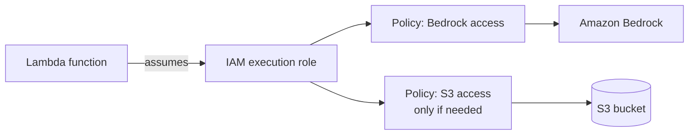

# AWS Bedrock + LangChain on AWS Lambda

How to deploy the code from `basic_bedrock.ipynb` as an **AWS Lambda function** that calls **Amazon Bedrock** (Claude Sonnet 4.6) through LangChain.

## Architecture

```mermaid
flowchart LR
    A[Test event / client<br/>{"question": "..."}] --> B[Lambda function]
    L[Lambda Layer<br/>langchain + langchain-aws] -.provides packages.-> B
    B -->|IAM execution role| C[Amazon Bedrock]
    C --> D[Claude Sonnet 4.6]
    B -.optional.-> S[(S3 bucket)]
```

## Project structure

```
aws-bedrock-course/
├── basic_bedrock.ipynb        # notebook code that we deploy
├── aws-lambda-layers/
│   ├── requirements.txt       # packages for the layer
│   ├── python/                # created by pip install (do not rename)
│   └── layer.zip              # created by zip command
└── README.md
```

---

## 1. Deploy the code on a Lambda function

1. Open the **AWS Console** and go to **Lambda**.
2. Make sure the region at the top right is **Europe (Stockholm) `eu-north-1`**. The function, the layer and the Bedrock model must use the same region.
3. Click **Create function**, then **Author from scratch**.
   - Function name: for example `aws-bedrock-course-fun-1`
   - Runtime: **Python 3.12**
   - Architecture: **x86_64**
4. Paste the code from [step 5](#5-lambda-function-code) into `lambda_function.py` and click **Deploy**.

---

## 2. The problem: `No module named 'langchain_aws'`

When you run the code, Lambda shows:

```
Runtime.ImportModuleError: Unable to import module 'lambda_function': No module named 'langchain_aws'
```

**Why this happens:** a Lambda function only comes with the Python standard library and `boto3`. Third-party packages such as `langchain` and `langchain-aws` are **not installed by default**.

**Solution:** use a **Lambda Layer**. A layer is a zip file with extra packages that Lambda attaches to your function, so you do not have to put the packages inside the function code.

---

## 3. Build the layer

### 3.1 Create the folder and `requirements.txt`

```bash
mkdir -p ~/aws-bedrock-course/aws-lambda-layers
cd ~/aws-bedrock-course/aws-lambda-layers
```

Create `requirements.txt` with these dependencies:

```
langchain
langchain-aws
```

### 3.2 Install the packages for Lambda's environment

Run this inside the `aws-lambda-layers` folder (Ubuntu / WSL, Python 3.12):

```bash
cd ~/aws-bedrock-course/aws-lambda-layers

pip install \
  --platform manylinux2014_x86_64 \
  --target python \
  --implementation cp \
  --python-version 3.12 \
  --only-binary=:all: \
  --upgrade \
  -r requirements.txt
```

What the options mean:

| Option | Why |
|---|---|
| `--platform manylinux2014_x86_64` | Lambda runs on Linux, so download Linux-compatible packages |
| `--target python` | Install into a folder named **`python`**. Lambda only finds layer packages inside a top-level `python/` folder |
| `--implementation cp --python-version 3.12` | Match the Lambda runtime (CPython 3.12) |
| `--only-binary=:all:` | Use ready-made wheels, nothing is compiled on your laptop |
| `-r requirements.txt` | Read the package list from the file |

If `pip` is not found inside a `uv` virtual environment, use:

```bash
uv pip install \
  --python-platform x86_64-manylinux2014 \
  --python-version 3.12 \
  --target python \
  --only-binary :all: \
  -r requirements.txt
```

> If your Lambda function uses the **arm64** architecture, replace `manylinux2014_x86_64` with `manylinux2014_aarch64`.

### 3.3 Zip the `python` folder

```bash
cd ~/aws-bedrock-course/aws-lambda-layers
zip -r layer.zip python
```

Important: the zip must contain `python/` at the top level. The name of the parent folder (`aws-lambda-layers`) does **not** matter and is not part of the zip.

```
layer.zip
└── python/
    ├── langchain/
    ├── langchain_aws/
    ├── boto3/
    └── ...
```

Optional cleanup to reduce size:

```bash
find python -name "__pycache__" -type d -exec rm -rf {} +
rm -rf python/bin
zip -r layer.zip python
```

---

## 4. Upload the layer and attach it to the function

**Note:** Upload `layer.zip` to an **S3 bucket** first (same region). A zip larger than 50 MB cannot be uploaded directly in the console, and S3 also keeps a safe copy of the file.

1. **S3** → open your bucket → **Upload** → select `layer.zip`.
2. Copy the **S3 URL** of the object (looks like `https://<bucket>.s3.eu-north-1.amazonaws.com/layer.zip`).
3. **Lambda** → **Layers** → **Create layer**.
   - Name: for example `langchain-aws-layer`
   - Choose **Upload a file from Amazon S3** and paste the URL
   - Compatible runtimes: **Python 3.12**
   - Compatible architectures: **x86_64**
4. Open your function → scroll to **Layers** → **Add a layer** → **Custom layers** → select your layer and its version → **Add**.

Limits: the unzipped layer must be smaller than **250 MB** (the function code plus all layers together).

---

## 5. Lambda function code

```python
# Paste this into lambda_function.py in the AWS Lambda console
import json
from langchain_aws import ChatBedrockConverse


def lambda_handler(event, context):
    llm = ChatBedrockConverse(
        model="eu.anthropic.claude-sonnet-4-6",
        region_name="eu-north-1",
    )

    question = event['question']
    res = llm.invoke(question)

    return {
        'statusCode': 200,
        'body': json.dumps(res.content)
    }
```

Notes:

- The model ID has the **`eu.`** prefix because it is a cross-region inference profile for Europe. Use the prefix that matches your region (`us.` for US regions).
- **No API key is needed inside Lambda.** The function authenticates with its **IAM execution role** (see the next section). Do not put `AWS_BEARER_TOKEN_BEDROCK` or any access key in the code.

### Recommended function settings

Open **Configuration → General configuration → Edit**:

| Setting | Recommended | Why |
|---|---|---|
| Timeout | **30 to 60 seconds** | The default is 3 seconds, which is too short for an LLM call |
| Memory | **512 MB** or more | Importing LangChain is slow with very low memory |

### Test event

Click **Test** and create an event with this JSON:

```json
{
  "question": "Explain AWS Bedrock in two simple lines"
}
```

---

## 6. Permissions: allow Lambda to call Bedrock

By default a Lambda function is **not allowed** to call Bedrock. You give it permission by adding policies to its **execution role**.

1. Open your function → **Configuration** tab → **Permissions**.
2. Under **Execution role**, click the **role name**. This opens the role in IAM.
3. Click **Add permissions** → **Attach policies**.
4. Search for and select **`AmazonBedrockFullAccess`** → **Add permissions**.



### If the same function also uses S3 or other services

Attach one policy per service the function needs, for example:

| Need | Policy |
|---|---|
| Bedrock | `AmazonBedrockFullAccess` |
| S3 | `AmazonS3FullAccess` (or read-only) |

For quick learning and experiments, you can attach **`AdministratorAccess`** to the role so that every service works. This is convenient but **not safe for real projects**, because the function can then do anything in your account. Before using it in production, replace it with the specific policies above, or a custom policy limited to the exact model and bucket.

---

## 7. Troubleshooting

| Error | Cause | Fix |
|---|---|---|
| `No module named 'langchain_aws'` | Layer is missing or not attached | Attach the layer (section 4) |
| Still `No module named ...` after attaching | Zip does not have `python/` at the top level, or wrong Python version or architecture | Rebuild the zip from inside `aws-lambda-layers` with `zip -r layer.zip python` |
| `Task timed out after 3.00 seconds` | Default timeout is too short | Set timeout to 30 to 60 seconds |
| `AccessDeniedException` | Execution role has no Bedrock permission | Attach a Bedrock policy (section 6) |
| `ValidationException: Operation not allowed` | AWS account-level restriction on Bedrock model invocation | Fill in the Anthropic use case form in the Bedrock console. If it is blocked, open an AWS Support case (Account and billing) |
| `ValidationException` about the model ID | Wrong prefix or the model is not available in this region | Check the exact ID under Bedrock → Model catalog and use the matching prefix (`eu.` or `us.`) |

---

## Quick checklist

- [ ] Function created with Python 3.12 and the right architecture
- [ ] `requirements.txt` has `langchain` and `langchain-aws`
- [ ] Packages installed into `python/` with the `pip install --platform ...` command
- [ ] `layer.zip` created with `python/` at the top level
- [ ] `layer.zip` uploaded to S3 and the layer created in the same region
- [ ] Layer attached to the function
- [ ] Timeout set to 30 to 60 seconds
- [ ] Execution role has Bedrock permission
- [ ] Test event `{"question": "..."}` returns `statusCode: 200`